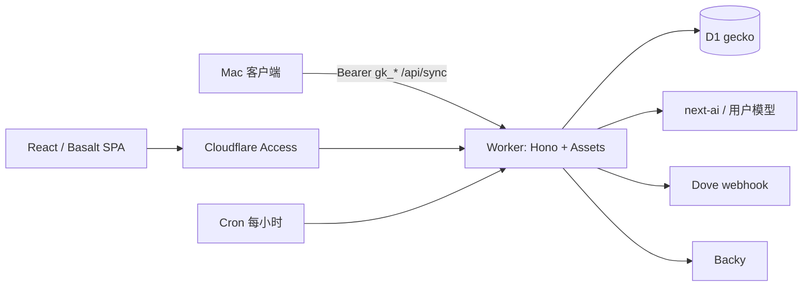

# 14 — Web 迁 Vite，并全面落到 Cloudflare

> **状态**：待 Review  
> **日期**：2026-10-16  
> **范围**：只改 Web 控制台与托管。Mac 客户端保持现有同步协议。  
> **模板**：GeekHub（Vite + Hono + Access + D1 + 隔离测试），Giraffe（Access + 机器 API token）。

本文是实施前的设计。通过后再动手。不保留 Node / Docker / Railway / D1 REST / NextAuth 兼容层。

---

## 需要确认的决策

| # | 题目 | 推荐 | 备选 |
|---|---|---|---|
| D1 | 目标形态 | Vite SPA + Hono Worker + D1 binding | 把现有 vinext 部署到 Workers |
| D2 | 人机登录 | Cloudflare Access（`nocoo` team） | 在 Worker 上重做 Google OAuth |
| D3 | `user_id` | Access email 小写，一次性把现有 Google `providerAccountId` 行 remap | 用 Access `sub`；或像 GeekHub 去掉分区、单租户 |
| D4 | `POST /api/sync` | 请求内写入 D1，成功后仍返回 **202** | 改 Mac 客户端接受 200 |

下面按推荐方案写。D2/D3 会影响现有 D1 行和登录方式，需要先拍板。

---

## 现状

Web 已经是 vinext（Vite 上的 Next App Router），但生产形态仍是 **Railway 容器 + Node 运行时 + D1 REST**。

```
Mac ──Bearer gk_*──► Railway Node (vinext start :7018)
人  ──Google OAuth──► 同上
                         │  HTTPS REST + API token
                         ▼
                    Cloudflare D1  gecko
                    (f66490d2-e7b3-43e8-a30c-2b34111141d7)
```

| 层 | 现在 | 问题 |
|---|---|---|
| 框架 | `vinext@1.0.0-beta.0` + `next@16.3.8` | 页面几乎全是 `"use client"`，RSC 没有带来收益 |
| 运行时 | Dockerfile：Bun 构建、`node:22-slim` 运行 | Bun 对 vinext 大 POST body 会挂死；容器只为绕开这个问题 |
| 数据 | `src/lib/d1.ts` 走 D1 HTTP API；本地 `better-sqlite3` | Workers 最佳实践明确：能用 binding 就不要打 REST |
| 登录 | NextAuth Google + `ALLOWED_EMAILS` | vinext 下关掉了 OAuth PKCE/state；JWT `user.id` 曾经用错过随机 UUID |
| 同步 | 内存 `SyncQueue`，2s drain，返回 202 | Worker isolate 没有进程级内存队列，掉请求就丢数据 |
| 定时 | `instrumentation.ts` → `HourlyScheduler` `setInterval` | vinext 生产不会保证启动 instrumentation；Worker 上也没有常驻进程 |
| 健康 | `/api/live` 含 `process.uptime()` | Worker 没有这个进程寿命语义 |
| 测试 | L2/L3 共用 `.local/gecko-test.db`，`E2E_SKIP_AUTH=true` | 与「每轮独立 persist 目录 + `_test_marker`」规范不符 |
| 托管 | 无 GitHub deploy workflow；Railway 连 GitHub | `gecko.hexly.ai` 不在 Workers |

页面侧 Next 依赖很薄，迁移成本主要在 API 与运行时，不在 UI：

- `"use client"`：仪表盘、会话、应用、设置、AI、Backy、登录几乎全覆盖
- 仍绑 Next 的点：`next/font/google`、`next/image`、`next/link`、`next/navigation`、`src/proxy.ts`、`src/auth.ts`、`src/lib/vinext-request-shim.ts`、`/daily` 服务端 `redirect`

Mac 端 **不改协议**：`POST /api/sync` Bearer `gk_*`，批次 250，把 202 当作已接收（见 `DatabaseManager` v3 `synced_at`）。

---

## 为什么不把 vinext 直接部署到 Workers

vinext 的 Cloudflare 目标能去掉 Docker，但仍会留下：

1. NextAuth / `proxy.ts` / vinext cookie 问题
2. 内存 `SyncQueue` 与 `setInterval` 调度，必须重写
3. D1 REST 仍要改成 binding
4. 页面继续假装 RSC
5. `vinext` 仍是 beta，本仓库已为它写过 shim 和 SSR external

同类仓库（GeekHub、Giraffe、life.ai、wooly、noheir、rio）的完成态是：**Vite SPA + `@cloudflare/vite-plugin` + Hono + wrangler + D1 binding**。Gecko 走同一条路。

---

## 目标形态



| 角色 | 实现 |
|---|---|
| 浏览器 | Vite 8 + React 19 + React Router 8 + Basalt + TanStack Query |
| 入口 | Cloudflare Access JWT（`jose` 验签，抄 GeekHub `src/worker/auth.ts`） |
| 机器 | 现有 `api_keys` + `requireApiKey`，路径不变 |
| API | Hono，挂在同一个 Worker；`run_worker_first = ["/api", "/api/*"]` |
| 数据 | `env.DB` D1 binding，删除 REST 客户端和 `better-sqlite3` |
| 静态 | Workers Static Assets，SPA `not_found_handling` |
| 定时 | Cron `0 * * * *` 跑 auto-analyze；AI I/O 用 `waitUntil` |
| 本地 | `CLOUDFLARE_ENV=local` + Vite plugin，端口 **7018**；Caddy `gecko.dev.hexly.ai` 不变 |
| 生产 | Worker `gecko`，自定义域 `gecko.hexly.ai`，关掉 `workers.dev` 和 preview URL |
| 测试 | 每轮独立 `persist-to`，禁止 `remote: true`，写入 `_test_marker` |

参考实现（只抄结构，不抄业务）：

| 能力 | 来源 |
|---|---|
| Vite plugin、Access、D1、next-ai、隔离 harness、deploy 脚本 | `/Users/nocoo/workspace/personal/geekhub` |
| 人机 Access + `/api/v1` 机器 token | `/Users/nocoo/workspace/personal/giraffe` |
| 本地测试隔离 | nmem `20eebbc1-759f-45b9-be7f-666ccc03d2e0` |
| 新站用 Workers + Assets，不用 Pages | nmem `6436c9a7-1764-474a-a006-fc09722e8397` |

---

## 目录

Web 仍在 `apps/web-dashboard/`，与 `apps/mac-client/` 并列。

```
apps/web-dashboard/
  wrangler.jsonc
  vite.config.ts
  migrations/                 # 从 drizzle/ 迁过来，wrangler D1 migrations
  src/web/                    # 浏览器：路由、页面、组件
  src/worker/                 # Hono、auth、cron、repos
  src/shared/                 # 契约、校验、version
  scripts/deploy.ts
  scripts/run-tests.ts        # L2/L3 harness
  scripts/verify-test-bindings.ts
```

根目录 `package.json` 脚本继续 `bun run --cwd apps/web-dashboard …`。`wrangler.jsonc` 放在 web 包内，避免和 Mac 工程抢根配置。

---

## 认证

### 人

生产：校验 `cf-access-jwt-assertion` 的 RS256、issuer `https://nocoo.cloudflareaccess.com`、audience、`sub`、`email`。单独的邮箱 header 不算登录。写操作检查 Origin / Sec-Fetch-Site。

本地：仅 `ENVIRONMENT=local` 且回环（含 Caddy `gecko.dev.hexly.ai` + loopback peer）时注入本地身份。生产代码路径永不走这条。

删除：

- `src/auth.ts`、`src/app/api/auth/[...nextauth]/route.ts`、`src/components/auth-provider.tsx`
- `src/app/login/page.tsx`（Access 在边缘拦）
- `src/proxy.ts`、`src/lib/vinext-request-shim.ts`
- `GOOGLE_CLIENT_ID` / `SECRET`、`NEXTAUTH_*`、`ALLOWED_EMAILS`、`E2E_SKIP_AUTH`

Access 应用策略替代邮箱白名单。`/api/live` 在应用鉴权之前；监控对该路径做 bypass，其余路径仍要登录。Mac 的 Bearer 请求必须 **绕过 Access**（Access 服务令牌，或把 `/api/sync`、`/api/sync/status`、`/api/v1/*` 配成 bypass，由 Worker 内 `requireApiKey` 把关）。推荐 **路径 bypass + Worker 验 key**，Mac 不需要再持有 Access service token。

### 机器

保持：

- `Authorization: Bearer gk_<hex>`
- SHA-256 查 `api_keys.key_hash`
- 返回 `user_id` + `device_id`，更新 `last_used`

`/api/keys` 仍要人的 Access 身份，不能只用 API key 自助签发。

### `user_id`（D3）

现网 D1 按 Google `account.providerAccountId` 分区。Access 的稳定值是 email（或 `sub`）。

推荐：

1. 生产 `user_id` 改为 Access email 小写
2. 上线前跑一次 remap：把当前唯一（或白名单内）Google id 的 `focus_sessions` / `api_keys` / settings 等行改成该 email
3. 保留 `user_id` 列（API key 仍绑定用户；以后多设备、多邮箱仍可用）

不推荐一上来就删分区。Gecko 的表已经按 `user_id` 建好，Mac key 也绑在上面。

---

## 数据与同步

删除 `src/lib/d1.ts` 的 REST 与 `better-sqlite3`。Worker 只使用 `c.env.DB`。查询辅助收到 `D1Database`，不再读 `process.env.CF_*`。

现有 drizzle SQL 挪到 `migrations/`，作为 wrangler 迁移基线。远程库 **已经应用过** 这些变更：首次 `wrangler d1 migrations apply gecko --remote` 必须识别为已应用，禁止重跑 `0001_cloud_init.sql`。本地 `env.local` 则从空库按文件顺序建。

`SyncQueue` 内存 drain 删除。`POST /api/sync`：

1. `requireApiKey`
2. 校验批次（上限 1000 不变）
3. `env.DB.batch(...)` 按 14 列、每语句 ≤100 bind（现有 `batchSize=7`）`INSERT OR IGNORE`
4. 全部成功后返回 **202**，body 保持 Mac 现有字段

失败返回 4xx/5xx，Mac 行的 `synced_at` 保持 NULL，下次再传。这比 202 之后异步 REST 更硬，也消掉 Bun 大 body hang。

Auto-analyze：Cron `0 * * * *` 调现有 `AutoAnalyzeService.tick` 逻辑。Gecko 是个人、每小时最多一次模型调用，先不用 Queue；若 CPU 不够再加。Dove、Backy 继续出站 HTTP，凭据改为 Worker secrets / D1 settings。

`/api/live` 对齐 GeekHub：`{ status, version, storage: "d1" }`，去掉 `process.uptime()`。

---

## 前端

`src/app/**` 页面挪到 `src/web/`，用 React Router 8 对齐现有路径：

| 路径 | 处理 |
|---|---|
| `/` | 仪表盘 |
| `/daily` | 客户端按 timezone 跳到 `/daily/:date` |
| `/daily/:date` | 每日回顾 |
| `/sessions` `/apps` | 原页面 |
| `/integrations/api` | API key |
| `/settings` `/settings/ai` `/settings/backy` `/settings/categories` `/settings/tags` | 原页面 |
| `/login` | 删除 |

替换：

- `next/link` → `react-router` `Link`
- `usePathname` / `useRouter` / `useSearchParams` → react-router
- `next/image` → ``（logo 已在 `public/`）
- `next/font/google` → 现有 CSS 变量 + 系统/自托管字体
- `useSession()` → `/api/me` 或 Access 注入的 session 端点

`@nocoo/next-ai` 继续：设置面板走包的 React 入口，Worker 只引用 `@nocoo/next-ai/server`。GeekHub 已证明该包可在 Worker 跑（必要时保留 `nodejs_compat`）。浏览器依赖图不得打进 `/server`。

---

## wrangler

`apps/web-dashboard/wrangler.jsonc` 要点：

```jsonc
{
  "name": "gecko",
  "main": "src/worker/index.ts",
  "compatibility_date": "2026-10-16",
  "compatibility_flags": ["nodejs_compat"],
  "workers_dev": false,
  "preview_urls": false,
  "routes": [{ "pattern": "gecko.hexly.ai", "custom_domain": true }],
  "assets": {
    "binding": "ASSETS",
    "not_found_handling": "single-page-application",
    "run_worker_first": ["/api", "/api/*"]
  },
  "triggers": { "crons": ["0 * * * *"] },
  "d1_databases": [{
    "binding": "DB",
    "database_name": "gecko",
    "database_id": "f66490d2-e7b3-43e8-a30c-2b34111141d7",
    "migrations_dir": "migrations"
  }],
  "observability": { "enabled": true, "traces": { "enabled": true } }
}
```

`env.local`：无自定义域、本地 D1 id、`ENVIRONMENT=local`、`RESOURCE_ENV=local`。Secrets（生产）：`DOVE_WEBHOOK_URL` 等现有出站凭据。AI 用户密钥仍按现逻辑进 D1，不进 wrangler vars。

Vite：

- `@cloudflare/vite-plugin`，`remoteBindings: false`
- `server.port = 7018`，`allowedHosts: ["gecko.dev.hexly.ai"]`
- 测试时 `GECKO_TEST_STATE` 指向本轮 persist 目录，并改 `cacheDir`

开发：`CLOUDFLARE_ENV=local vite --host 127.0.0.1`。不再 `vinext dev` / `vinext start`。

部署：抄 GeekHub `scripts/deploy.ts`——拒绝 local/test env，先 remote migrate，再 build，再 `wrangler deploy --tag v$VERSION`。仓库继续没有 GitHub deploy workflow，除非哥明确要 Workers Builds。

---

## 删除清单

| 路径 | 原因 |
|---|---|
| `apps/web-dashboard/Dockerfile` | 不再有 Node 容器 |
| `next` `vinext` `next-auth` `react-server-dom-webpack` | 离开 Next |
| `better-sqlite3` | 本地改 Miniflare SQLite |
| `src/auth.ts` `src/proxy.ts` `src/instrumentation.ts` | 运行时替换 |
| `src/lib/vinext-request-shim.ts` `src/lib/hourly-scheduler.ts` | 进程模型替换 |
| `src/lib/d1.ts` REST 分支 | 改 binding |
| `src/lib/sync-queue.ts` 的自动 drain | 请求内写入 |
| `.env.example` 里的 NextAuth / Google / `CF_API_TOKEN` | 改 Access + bindings |
| Railway 服务 | DNS 切到 Worker 并验证后再删 |

`src/lib/sync-queue.ts` 的 SQL builder（`COLUMNS`、`buildMultiRowInsert`）可以留在 worker 里当纯函数。

---

## API 清单（L2 必须 100%）

保持路径与方法，Hono 逐个挂上。删除 `/api/auth/*`。

| 方法 | 路径 | 鉴权 |
|---|---|---|
| GET | `/api/live` | 无 |
| GET | `/api/me` | Access（新建，给 SPA 用） |
| POST | `/api/sync` | API key |
| GET | `/api/sync/status` | API key 或 Access |
| GET | `/api/sessions` | Access |
| GET | `/api/stats` | Access |
| GET | `/api/stats/timeline` | Access |
| GET | `/api/apps` | Access |
| GET PUT DELETE | `/api/apps/notes` | Access |
| GET POST PUT DELETE | `/api/categories` | Access |
| GET PUT | `/api/categories/mappings` | Access |
| GET POST PUT DELETE | `/api/tags` | Access |
| GET PUT POST | `/api/tags/mappings` | Access |
| GET POST | `/api/keys` | Access |
| PATCH DELETE | `/api/keys/:id` | Access |
| GET | `/api/v1/snapshot` | API key |
| GET PUT | `/api/settings/timezone` | Access |
| GET PUT | `/api/settings/notifications` | Access |
| GET PUT | `/api/settings/ai` | Access |
| POST | `/api/settings/ai/test` | Access |
| GET | `/api/daily/summaries` | Access |
| GET | `/api/daily/:date` | Access |
| POST | `/api/daily/:date/preview-prompt` | Access |
| POST | `/api/daily/:date/analyze` | Access |
| GET PUT | `/api/backy/config` | Access |
| GET | `/api/backy/history` | Access |
| POST | `/api/backy/push` | Access |
| GET POST DELETE | `/api/backy/pull-key` | Access |
| POST | `/api/backy/pull` | Access |
| POST | `/api/backy/test` | Access |

---

## 6DQ

| 维 | 迁移后的证据 | 状态目标 |
|---|---|---|
| L1 web | Vitest；四项 ≥95.5%；覆盖 worker 纯函数、web 组件、shared 校验 | 保持 enforced 门槛 |
| L1 native | 不变 | 现有 planned / 回归地板 |
| L2 | 真实本地 Worker HTTP，覆盖上表全部 method 组合；端口 **17018** | 从 planned 收到可执行 harness |
| L3 | Playwright 走 **27018** 的独立 persist；登录用本地身份，不再 `E2E_SKIP_AUTH` | 保持 enforced |
| G1 | `wrangler types` + 分 tsconfig（web / worker / tools）；Biome 零警告 | 保持 |
| G2 | 现有 gitleaks/OSV；去掉 Docker 镜像体积门（若只扫 web 锁） | 保持 |
| D1 隔离 | 每轮 `mkdtemp` persist；拒绝 `CF_*` / `--remote`；`_test_marker`；L2 与 L3 与 `.wrangler/state` 互不复用 | 补齐规范 |

Harness 抄 `geekhub/scripts/run-tests.ts`：

1. 端口空闲检查（17018 / 27018）
2. `verifyLocalBindings(state)`：无 remote、路径在 `.wrangler/tests/`
3. 应用 migrations + `_test_marker`
4. `vite --port` 带 `GECKO_TEST_STATE`
5. 等 `/api/live` 与本地 session
6. 跑 HTTP 或 Playwright
7. SIGTERM，校验标记后再删本轮目录

L2 现在的 `bun test src/__tests__/e2e` + 自启 vinext 整段替换。单测继续 Vitest，用 Miniflare 或注入假 `D1Database`，不打生产。

Mac XCTest、SwiftLint、DMG、版本号同步 **不动**。

---

## 原子提交计划

实施时按下面拆 commit，每步可 typecheck / lint / 相关测试。不在本文 commit 里改代码。

1. `chore: add wrangler and vite worker skeleton`  
   wrangler.jsonc、vite plugin、空 Hono、`/api/live`、删除 Dockerfile 引用（先不删业务）。
2. `feat: bind d1 and port sql helpers`  
   `env.DB`、migrations 搬家、删 REST/`better-sqlite3`。
3. `feat: add access and api-key auth`  
   Access + `requireApiKey`；`/api/me`。
4. `feat: port sync to in-request d1 batch`  
   请求内写入，保留 202；删内存 drain。
5. `feat: port remaining hono api routes`  
   按上表搬完，删 `src/app/api`。
6. `feat: move dashboard to react router spa`  
   `src/web`，删 Next 页面与 next/auth。
7. `feat: run auto-analyze on cron trigger`  
   删 `HourlyScheduler` / `instrumentation.ts`。
8. `test: isolate l2 l3 on local worker`  
   harness、`_test_marker`、端口 17018/27018。
9. `chore: drop vinext next and railway files`  
   依赖、Dockerfile、env 样例、AGENTS/README。
10. `docs: record worker cutover`  
    自定义域、Access、Railway 下线证据。

发布仍走现有 `bun run release` 协调 Web/Mac 版本；Worker tag 用同一 X.Y.Z。

---

## 上线顺序

1. 本地 L1/L2/L3 全绿。
2. 绑定 **现有** D1 `gecko`，不要新建库。
3. 在 Cloudflare Zero Trust 建 Access 应用：`gecko.hexly.ai`，team `nocoo`，bypass `/api/live`、`/api/sync`、`/api/sync/status`、`/api/v1/*`。
4. 执行 D3 remap（先 dump 再更新 `user_id`）。
5. `bun run deploy` 到 Worker，绑定自定义域。
6. 验证：`curl https://gecko.hexly.ai/api/live` 含 `cf-ray` 且 `storage=d1`；浏览器 Access 登录；Mac 指向 `https://gecko.hexly.ai` 同步一轮。
7. 删除 Railway 服务与 Dockerfile。DNS 只留 Worker 自定义域。

本机 Caddy **保持** `gecko.dev.hexly.ai → 7018`。不改端口。

---

## 明确不在本次

- Mac 跟踪引擎、Keychain、本地 SQLite
- 改同步 JSON 字段或批次大小
- 产品路线图 08 里的新可视化
- Basalt 视觉审计（现有控件可继续用）
- 把 CLI 从 wrangler 迁到 `cf`
- 建远程 `-test` Worker / D1
- Workers Builds / GitHub 自动部署（可后续单独做）

---

## 验收

- 生产 `https://gecko.hexly.ai` 由 Worker 提供，响应带 Cloudflare 头
- 仪表盘经 Access；Mac 仍用 API key 同步，202 语义不变
- D1 为 binding，仓库中无 `CF_API_TOKEN` 业务调用
- 无 Docker、无 vinext、无 NextAuth
- 自动分析由 Cron 触发，进程内 `setInterval` 不存在
- L2 覆盖全部 API method；L3 覆盖登录后的日览、同步状态、设置
- L2/L3 使用独立本地 SQLite，带 `_test_marker`，无生产凭据
