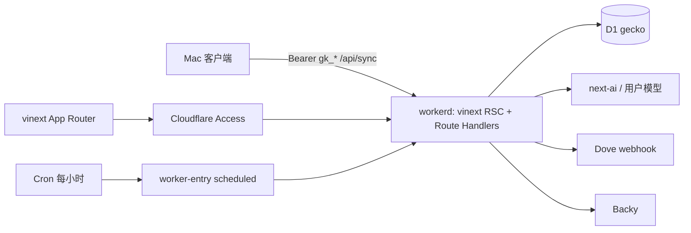

# 14 — vinext 直部 Cloudflare，Google 迁 Access

> **状态**：D2 已确认；D1 改为 vinext 直部 Workers。待确认 D3 / D5。  
> **日期**：2026-10-16  
> **范围**：只改 Web 控制台与托管。Mac 同步协议不变。  
> **主路径**：现有 vinext App Router + `@cloudflare/vite-plugin` + D1 binding + Access。  
> **兜底**：若 workerd 跑不通（大 POST、next-ai、Cron entry），再拆成 GeekHub 式 Vite SPA + Hono。

Gecko **已经在 Vite 上**（`vinext()` 插件）。缺的是 Cloudflare 部署目标：现在 `vite.config.ts` 只有 `vinext()`，生产用 `vinext start` 跑 Node 容器。按 [vinext Cloudflare 文档](https://vinext.dev/docs/deploying/cloudflare)，补上 Cloudflare Vite 插件和 `cloudflare.config.ts` 即可在 workerd 里跑同一套 `src/app`，不必重写成 SPA。

不保留 Node / Docker / Railway / D1 REST / NextAuth / Google OAuth。

---

## 决策

| # | 题目 | 结论 | 说明 |
|---|---|---|---|
| D1 | 目标形态 | **vinext 直部 Workers** | 页面和 Route Handler 留在 `src/app`。Hono 重写仅作兜底 |
| D2 | 人机登录 | **Cloudflare Access**（已确认） | 替换 Google OAuth / NextAuth / `ALLOWED_EMAILS` |
| D3 | `user_id` | 推荐 Access email 小写 + 一次性 remap | 仍待确认；备选 Access `sub` |
| D4 | `POST /api/sync` | 请求内写 D1，成功仍返回 **202** | Mac `synced_at` 语义不变 |
| D5 | CLI / 配置 | 推荐 `cloudflare.config.ts` + `cf` | vinext init 默认；GeekHub 的 wrangler.jsonc 作备选 |

---

## 现状

```
Mac ──Bearer gk_*──► Railway Node (vinext start :7018)
人  ──Google OAuth──► 同上
                         │  HTTPS REST + CF_API_TOKEN
                         ▼
                    Cloudflare D1  gecko
                    (f66490d2-e7b3-43e8-a30c-2b34111141d7)
```

| 层 | 现在 | 迁 Workers 时怎么处理 |
|---|---|---|
| 框架 | `vinext@1.0.0-beta.0`，`vite.config.ts` 仅 `vinext()` | 加上 Cloudflare Vite 插件，RSC 环境跑在 workerd |
| 页面 | 几乎全是 `"use client"`，仍用 `next/link`、`next/navigation` | **保留** `src/app` |
| API | `src/app/api/**/route.ts`，`Request`/`Response` | **保留路径**；内部改 binding / Access |
| 运行时 | Dockerfile：Bun 构建、`node:22-slim` 跑 `vinext start` | 删除。Bun 大 POST hang 是 Node/Bun 流问题，workerd 不走那条路径 |
| 数据 | `src/lib/d1.ts` REST + 本地 `better-sqlite3` | `import { env } from "cloudflare:workers"` 的 `env.DB` |
| 登录 | NextAuth Google；`proxy.ts` 用 session cookie | Access JWT；删 NextAuth |
| 同步 | 内存 `SyncQueue` 2s drain，返回 202 | 请求内 `DB.batch`，仍 202 |
| 定时 | `instrumentation.ts` → `setInterval` | Worker `scheduled` + Cron `0 * * * *` |
| 健康 | `/api/live` 含 `process.uptime()` | `{ status, version, storage: "d1" }` |
| 测试 | `.local/gecko-test.db` + `E2E_SKIP_AUTH` | 每轮独立 persist + `_test_marker` + 本地身份 |
| 托管 | Railway | Worker `gecko`，域 `gecko.hexly.ai` |

Mac **不改协议**：`POST /api/sync` Bearer `gk_*`，批次 250，把 202 当作已接收（`DatabaseManager` v3 `synced_at`）。

---

## 为什么直部，而不是再写一套 Vite SPA

vinext 的定位就是「Next API 跑在 Vite 上，Cloudflare Workers 是第一部署目标」：

- 开发 / 构建已经是 Vite 8（本仓库 `vite@8.3.1`）
- `npx @vinext/cloudflare deploy`（或 `vinext init --platform=cloudflare` 生成的脚本）把 RSC 打进 workerd
- 服务端用 `import { env } from "cloudflare:workers"` 读 D1 / secrets，不用自写 Worker fetch 壳
- Route Handler 已是 Web `Request`/`Response`，和 Workers 模型一致
- 页面侧 Next 依赖只剩 font / image / link / navigation / `proxy.ts` / `auth.ts`，这些 vinext 都支持

上一版把 GeekHub 的 Hono 重写当主路径，会重做约 48 个 API method 和全部页面路由，只为离开一个已经在 Vite 上的框架。直部省掉那一层。

Hono 重写仍保留为 **退出条件**（见文末）。触发后再动 `src/app`。

---

## 目标形态



| 角色 | 实现 |
|---|---|
| UI / API | 现有 `src/app`，vinext App Router |
| 运行时 | `@cloudflare/vite-plugin`，`viteEnvironment.name = "rsc"` |
| 人 | Access JWT，`jose` 验签（抄 GeekHub `src/worker/auth.ts`） |
| 机器 | 现有 `api_keys` + `requireApiKey` |
| 数据 | `env.DB` D1 binding |
| 定时 | 自定义 `worker-entry.ts` 导出 `scheduled`，Cron `0 * * * *` |
| 本地 | 端口 **7018**，Caddy `gecko.dev.hexly.ai` |
| 生产 | Worker `gecko`，自定义域 `gecko.hexly.ai`，关掉 workers.dev / preview |
| 测试 | 每轮独立 persist，禁止 remote binding |

参考：

| 能力 | 来源 |
|---|---|
| vinext + CF 插件 + `cloudflare:workers` | [vinext.dev/docs/deploying/cloudflare](https://vinext.dev/docs/deploying/cloudflare) |
| Access 验签、隔离 harness、next-ai 在 Worker | GeekHub |
| 机器 API key 与 Access 并存 | Giraffe `/api/v1` |
| 本地测试隔离 | nmem `20eebbc1-759f-45b9-be7f-666ccc03d2e0` |

---

## 目录（主路径）

Web 仍在 `apps/web-dashboard/`。`src/app` 不拆成 `src/web` + `src/worker`。

```
apps/web-dashboard/
  cloudflare.config.ts          # cf：Worker 名、域、D1、Cron、secrets
  vite.config.ts                # vinext() + cloudflare({ viteEnvironment: { name: "rsc" } })
  worker-entry.ts               # 默认 re-export vinext/server/app-router-entry + scheduled
  migrations/                   # 从 drizzle/ 搬来
  src/app/                      # 页面与 Route Handler，保留
  src/lib/d1.ts                 # 改为 env.DB
  src/lib/access.ts             # 新建：验 Access / 本地身份
  scripts/deploy.ts
  scripts/run-tests.ts
  scripts/verify-test-bindings.ts
```

`vinext init --platform=cloudflare` 会改 `vite.config.ts` 并生成 `cloudflare.config.ts`。本仓库已有手工 `vite.config.ts`（`@` alias、ssr.external），**不要 `--force` 覆盖**；按 AST 合并插件，或手写等价配置。

---

## Vite 与 Cloudflare 配置

### `vite.config.ts`

```ts
import { cloudflare } from "@cloudflare/vite-plugin";
import vinext from "vinext";
import { defineConfig } from "vite";

export default defineConfig({
  plugins: [
    vinext(),
    cloudflare({
      viteEnvironment: { name: "rsc", childEnvironments: ["ssr"] },
      remoteBindings: false,
    }),
  ],
  resolve: { alias: { "@": /* src */ } },
  server: {
    host: "127.0.0.1",
    port: 7018,
    strictPort: true,
    allowedHosts: ["gecko.dev.hexly.ai"],
  },
});
```

删掉现在的 `ssr.external: ["@vercel/oidc", "better-sqlite3", "bindings"]`：NextAuth 和 better-sqlite3 一起走。`@` alias 保留（TypeScript 7 路径加载问题仍在）。

vinext 文档要求 `runWorkerFirst` 覆盖页面和 `public/`，并排除 `/_next/static`，否则 hashed 资源 404。以 init 生成值为准：

```ts
runWorkerFirst: ["/*", "!/_next/static/*", "!/*/_next/static/*"]
```

### `cloudflare.config.ts`（D5 推荐）

vinext 当前默认走 `cf` + typed config，不是 wrangler.jsonc。要点：

- Worker 名 `gecko`
- `compatibility_date` 用实施当日；`nodejs_compat`（next-ai / `jose`）
- `workers_dev: false`，`preview_urls: false`
- 自定义域 `gecko.hexly.ai`
- `env.DB = bindings.d1({ name: "gecko" })`，绑定现有 id `f66490d2-e7b3-43e8-a30c-2b34111141d7`
- Cron `0 * * * *`
- 本地 env：无自定义域、`ENVIRONMENT=local`、`RESOURCE_ENV=local`
- Secrets：`DOVE_WEBHOOK_URL`、`DOVE_WEBHOOK_TOKEN` 等；AI 用户密钥仍在 D1
- `main` / Worker entry 指向 `worker-entry.ts`，以便挂 `scheduled`

类型：`.cloudflare/types` 加入 `tsconfig.json` `include`，gitignores。独立 typecheck 前跑 `cf workers types`。

实施时以 `vinext init --platform=cloudflare` 实际生成的 API 为准，不要抄过期字段名。`cf` 仍是 beta；若生成物或本地隔离达不到 D1 规范，改走 `--legacy-wrangler-cloudflare-init`（D5 备选），配置形状对齐 GeekHub `wrangler.jsonc`。

### `worker-entry.ts`

vinext 默认入口 `vinext/server/app-router-entry` 只处理 fetch。Cron 需要同模块导出 `scheduled`：

```ts
export { default } from "vinext/server/app-router-entry";

export async function scheduled(
  _event: ScheduledEvent,
  env: Env,
  ctx: ExecutionContext,
): Promise<void> {
  ctx.waitUntil(runAutoAnalyzeTick(env));
}
```

`runAutoAnalyzeTick` 使用传入的 `env.DB`，禁止再碰模块级 `setInterval`。

---

## 认证（D2 已确认）

### 人：Access

生产：读 `cf-access-jwt-assertion`，RS256，issuer `https://nocoo.cloudflareaccess.com`，audience 来自 config，要求 `sub` 与 `email`。单独邮箱 header 不算登录。写操作查 Origin / Sec-Fetch-Site。

`user_id`（D3 推荐）：Access email 小写。上线前 remap 现网 Google `providerAccountId` 行。保留 `user_id` 列，API key 仍绑定用户。

本地：仅 `ENVIRONMENT=local` 且回环（含 Caddy `gecko.dev.hexly.ai` + loopback peer）时注入本地身份。生产永不走这条。测试用 `RESOURCE_ENV=test` + `_test_marker`，删除 `E2E_SKIP_AUTH`。

Zero Trust 应用：`gecko.hexly.ai`，team `nocoo`。bypass：

- `GET /api/live`（监控）
- `/api/sync`、`/api/sync/status`、`/api/v1/*`（Mac Bearer；Worker 内 `requireApiKey`）

其余路径由 Access 拦。Mac 不持有 Access service token。

### 机器

保持 `Authorization: Bearer gk_<hex>` → SHA-256 → `api_keys.key_hash` → `user_id` + `device_id`，更新 `last_used`。`/api/keys` 仍要人的 Access 身份。

### 代码改动

| 文件 | 动作 |
|---|---|
| `src/lib/access.ts` | 新建：`verifyAccess`、`localRequest`、`requireSession` |
| `src/lib/api-helpers.ts` | `requireSession` 改调 Access；删 `auth()` |
| `src/proxy.ts` | 不再包 NextAuth。放行 live / Bearer / 静态；未登录页面 302 到 Access 登录（生产由边缘拦，本地跳过） |
| `src/auth.ts` | 删除 |
| `src/app/api/auth/[...nextauth]/route.ts` | 删除 |
| `src/components/auth-provider.tsx` | 删除；页面不再 `useSession` |
| `src/app/login/page.tsx` | 删除 |
| `src/lib/vinext-request-shim.ts` | 随 NextAuth cookie 问题一起删 |
| 各 `"use client"` 页 | `useSession()` → `GET /api/me`（新建，Access） |

环境变量删除：`GOOGLE_CLIENT_*`、`NEXTAUTH_*`、`ALLOWED_EMAILS`、`E2E_SKIP_AUTH`、`USE_SECURE_COOKIES`。Dove / Backy 改为 Worker secrets。

---

## 数据与同步

`src/lib/d1.ts` 改为：

```ts
import { env } from "cloudflare:workers";

export function db(): D1Database {
  return env.DB;
}
```

`query` / `execute` 走 `db().prepare(...).bind(...).all()` / `run()` / `batch()`。删除 REST URL、`CF_ACCOUNT_ID`、`CF_API_TOKEN`、`CF_D1_DATABASE_ID`、`D1_LOCAL_PATH`、`better-sqlite3`。本地由 Vite 插件的 Miniflare 提供同一 `env.DB`。

L1 单测不要 `import "cloudflare:workers"` 打真实 workerd：给 repos 注入 `D1Database` 假对象，或在 Vitest 里 mock 该模块。

drizzle SQL 搬到 `migrations/`。远程库已经应用过这些文件：第一次 remote migrate 必须记成已应用，禁止重跑 `0001_cloud_init.sql`。本地从空库按序建。

`SyncQueue` 自动 drain 删除。`POST /api/sync`（`src/app/api/sync/route.ts`）：

1. `requireApiKey`
2. 校验批次（上限 1000）
3. `env.DB.batch`，14 列、每语句 bind ≤100（现 `batchSize=7`）`INSERT OR IGNORE`
4. 成功返回 **202**，body 字段不变

失败 4xx/5xx，Mac `synced_at` 保持 NULL。`src/lib/sync-queue.ts` 的 `COLUMNS` / `buildMultiRowInsert` 留作纯函数。

`/api/live`：`SELECT 1` 探 `env.DB`，返回 `{ status, version, storage: "d1" }`，去掉 `process.uptime()` 和 `getD1Config()`。

Dove / Backy 继续出站 HTTP。`NEXTAUTH_URL` 用作 dashboard 链接的地方改为固定生产 URL 或 Worker var `DASHBOARD_URL=https://gecko.hexly.ai`。

---

## 前端（主路径不搬家）

保留：

- `src/app/**/page.tsx` 与 layout
- `next/link`、`next/navigation`、`next/image`
- `/daily` 服务端 `redirect`（timezone 逻辑可留在 server component）

删除登录页。仪表盘不再包 `SessionProvider`。`/api/me` 给需要显示邮箱/名的壳用。

`next/font/google`：vinext 从 CDN 加载 Google Fonts，生产可接受；若 Access 下字体请求有问题，再改自托管。

`@nocoo/next-ai`：设置面板走包的 React 入口；Route Handler 只引用 `@nocoo/next-ai/server`。GeekHub 已在 Worker 跑过（`nodejs_compat`，必要时包补丁）。浏览器依赖图不得打进 `/server`。

---

## API 清单（L2 100%）

路径与方法保持在现有 Route Handler。删除 `/api/auth/*`。新增 `GET /api/me`。

| 方法 | 路径 | 鉴权 |
|---|---|---|
| GET | `/api/live` | 无 |
| GET | `/api/me` | Access |
| POST | `/api/sync` | API key |
| GET | `/api/sync/status` | API key 或 Access |
| GET | `/api/sessions` | Access |
| GET | `/api/stats` | Access |
| GET | `/api/stats/timeline` | Access |
| GET | `/api/apps` | Access |
| GET PUT DELETE | `/api/apps/notes` | Access |
| GET POST PUT DELETE | `/api/categories` | Access |
| GET PUT | `/api/categories/mappings` | Access |
| GET POST PUT DELETE | `/api/tags` | Access |
| GET PUT POST | `/api/tags/mappings` | Access |
| GET POST | `/api/keys` | Access |
| PATCH DELETE | `/api/keys/:id` | Access |
| GET | `/api/v1/snapshot` | API key |
| GET PUT | `/api/settings/timezone` | Access |
| GET PUT | `/api/settings/notifications` | Access |
| GET PUT | `/api/settings/ai` | Access |
| POST | `/api/settings/ai/test` | Access |
| GET | `/api/daily/summaries` | Access |
| GET | `/api/daily/:date` | Access |
| POST | `/api/daily/:date/preview-prompt` | Access |
| POST | `/api/daily/:date/analyze` | Access |
| GET PUT | `/api/backy/config` | Access |
| GET | `/api/backy/history` | Access |
| POST | `/api/backy/push` | Access |
| GET POST DELETE | `/api/backy/pull-key` | Access |
| POST | `/api/backy/pull` | Access |
| POST | `/api/backy/test` | Access |

---

## 6DQ

| 维 | 证据 | 目标 |
|---|---|---|
| L1 web | Vitest；四项 ≥95.5%；mock `cloudflare:workers` 或注入 D1 | 保持门槛 |
| L1 native | 不变 | 现有 planned |
| L2 | 本地 workerd HTTP，覆盖上表全部 method；端口 **17018** | harness 可执行 |
| L3 | Playwright **27018** 独立 persist；本地身份，无 `E2E_SKIP_AUTH` | 保持 enforced |
| G1 | `cf workers types` + tsc + Biome 零警告 | 保持 |
| G2 | gitleaks / OSV；去掉 Docker 镜像门 | 保持 |
| D1 隔离 | 每轮 `mkdtemp` persist；拒绝 `CF_*` / remote；`_test_marker` | 补齐规范 |

Harness 对齐 GeekHub `scripts/run-tests.ts`，进程改为 `vite --port 17018|27018`（vinext + CF 插件）：

1. 端口空闲
2. `verifyLocalBindings(state)`：无 remote、路径在测试父目录
3. migrations + `_test_marker`
4. `GECKO_TEST_STATE` / persist path + `RESOURCE_ENV=test`
5. 等 `/api/live` 与 `/api/me`（本地身份）
6. HTTP 或 Playwright
7. SIGTERM，校验标记后删本轮目录

L2 现有「自启 vinext + `.local/gecko-test.db`」整段替换。单测不打生产。Mac XCTest / SwiftLint / DMG / 版本同步不动。

---

## 删除清单

| 路径 | 原因 |
|---|---|
| `apps/web-dashboard/Dockerfile` | 不再有 Node 容器 |
| `next-auth`、`src/auth.ts`、auth route、login 页、auth-provider | Access |
| `better-sqlite3` | Miniflare D1 |
| `src/instrumentation.ts`、`src/lib/hourly-scheduler.ts` | Cron `scheduled` |
| `src/lib/d1.ts` REST / `D1_LOCAL_PATH` | binding |
| `src/lib/sync-queue.ts` 自动 drain | 请求内写入 |
| `src/lib/vinext-request-shim.ts` | NextAuth cookie 特例 |
| `.env.example` 里 Google / NextAuth / `CF_API_TOKEN` | Access + bindings |
| Railway 服务 | DNS 切走并验证后 |

**保留** `vinext`、`next`（类型 / 兼容）、`react-server-dom-webpack`、`@vitejs/plugin-rsc`。

---

## 原子提交计划

每步可 typecheck / lint / 相关测试。

1. `chore: add cloudflare target to vinext`  
   合并 Vite 插件、`cloudflare.config.ts`、`worker-entry.ts` 先只 re-export fetch；本地 `vite dev :7018` 在 workerd 起来。暂不切生产。
2. `feat: use d1 binding instead of rest`  
   `src/lib/d1.ts` 改 `env.DB`；migrations 搬家；删 better-sqlite3 / REST。
3. `feat: replace nextauth with access`  
   `access.ts`、`/api/me`、改 `requireSession` / `proxy.ts`；删 Google / NextAuth。
4. `feat: write sync batches in request`  
   请求内 batch，保留 202；删 drain。
5. `feat: run auto-analyze on cron`  
   `scheduled`；删 instrumentation / HourlyScheduler。
6. `test: isolate l2 l3 on local workerd`  
   harness、`_test_marker`、端口 17018/27018。
7. `chore: drop docker and railway files`  
   Dockerfile、env 样例、AGENTS/README 运行时描述。
8. `docs: record worker and access cutover`  
   自定义域、Access bypass、remap、Railway 下线证据。

若第 1 步 workerd 无法稳定跑现有 dashboard（见退出条件），停在该 commit 之上，改写兜底方案，不把半套 Hono 和半套 vinext 混在 main。

发布仍用 `bun run release` 对齐 Web/Mac 版本；Worker tag 用同一 X.Y.Z。

---

## 上线顺序

1. 本地 L1/L2/L3 全绿，`vite dev` 经 Caddy `https://gecko.dev.hexly.ai` 可登录（本地身份）。
2. 绑定 **现有** D1 `gecko`，不新建库。
3. Zero Trust 应用 + bypass 列表。
4. D3 remap：先 dump `user_id` 分布，再把 Google id 更新为 Access email。
5. `npx @vinext/cloudflare deploy`（或仓库 `scripts/deploy.ts`：先 remote migrate，再 deploy，拒绝 local/test env）。
6. 验证：`curl -sI https://gecko.hexly.ai/api/live` 有 `cf-ray` 且 body `storage=d1`；浏览器走 Access；Mac 指向 `https://gecko.hexly.ai` 同步一轮（202）。
7. 删 Railway 与 Dockerfile。

端口与 Caddy 保持 7018 / 17018 / 27018。

---

## 退出条件（才改写 Hono SPA）

主路径失败再启用上一版 GeekHub 拆分。触发任一即停直部：

1. workerd 下 `POST /api/sync` ~85KB 仍挂或丢 body
2. `@nocoo/next-ai/server` 无法在 RSC/workerd 调模型（GeekHub 的包补丁也不够）
3. vinext 无法稳定导出 `scheduled`（自定义 entry 打不进 Cron）
4. Cloudflare Vite 插件与现有 `@` alias / vinext 1.0.0-beta.0 无法共存，且升级 vinext 会破坏 App Router
5. L2 无法在隔离 persist 的本地 Worker 上跑满 API 表

兜底目录与提交回到「`src/web` + `src/worker` + Hono」，API 路径与 Access / D1 / 202 语义与本文相同。

---

## 明确不在本次

- Mac 跟踪、Keychain、本地 SQLite
- 改同步 JSON 字段或批次大小
- 产品路线图 08 的新可视化
- Basalt 视觉审计
- 建远程 `-test` Worker / D1
- Workers Builds / GitHub 自动部署
- 未触发退出条件时重写 React Router / Hono

---

## 验收

- `https://gecko.hexly.ai` 由 Worker 提供，带 Cloudflare 头
- 仪表盘经 Access；Mac API key 同步，202 不变
- 服务端只用 D1 binding，无 `CF_API_TOKEN` 业务调用
- 无 Docker、无 NextAuth、无 Google OAuth
- 仍使用 vinext App Router（除非走了退出条件）
- 自动分析由 Cron `scheduled` 触发，无进程内 `setInterval`
- L2 覆盖全部 API method；L3 覆盖登录后的日览、同步状态、设置
- L2/L3 独立本地 SQLite + `_test_marker`，无生产凭据
